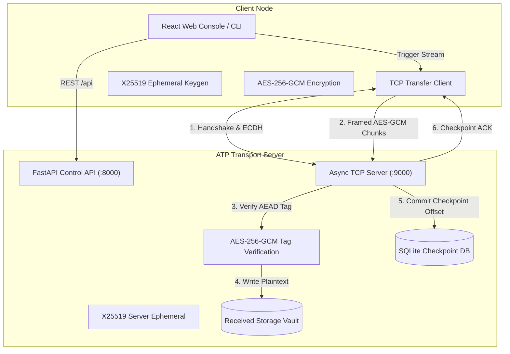

# Architecture & System Design

## 1. System Overview

The **Secure Multi-Client File Transfer Network (ATP)** is engineered around a clean separation of concerns:
- **TCP Application Data Plane**: Custom asynchronous TCP socket server executing framed, chunked, and authenticated byte transmission.
- **Cryptographic Security Plane**: Curve25519 Ephemeral ECDH key establishment, HKDF-SHA256 session key derivation, and AES-256-GCM authenticated chunk encryption.
- **State & Checkpoint Persistence Plane**: SQLite database tracking atomic chunk receipts, byte offsets, transfer metadata, and activity audit trails.
- **HTTP Control & Management Plane**: FastAPI REST endpoints providing health telemetry, file vault access, and configuration management.
- **Presentation Plane**: Modern React + TypeScript single-page application visually styled after the Agnos design language.

---

## 2. Component Separation

### 2.1 HTTP Control Plane vs TCP Data Plane
Ordinary web uploads (such as HTTP multipart forms) buffer large byte streams into RAM and lack fine-grained socket state resumption when wireless connections drop. In ATP:
- HTTP is utilized **strictly for management and telemetry** (checking health, listing files, reading security logs).
- The actual data transmission runs directly over raw **TCP stream sockets** on port 9000, governed by a custom binary framing header.

### 2.2 Client Isolation & Concurrency Model
The TCP engine uses an asynchronous event loop (`asyncio`) supporting concurrent client connections:
- Each connecting client receives a dedicated `ClientSession` context.
- Ephemeral cryptographic keys and session nonces are isolated per connection.
- Multi-threaded disk writes are non-blocking, and partial files are strictly segregated by transfer UUID (`data/uploads/{transfer_id}.part`).

### 2.3 Storage and Path Security
- **Staging / Uploads Directory**: `data/uploads/` holds active and interrupted partial files.
- **Received Storage Vault**: `data/received/` holds verified completed files.
- **Path Traversal Protection**: File requests canonicalize paths and enforce that accessed files reside strictly inside the received vault directory, preventing directory traversal attacks (`../`).
