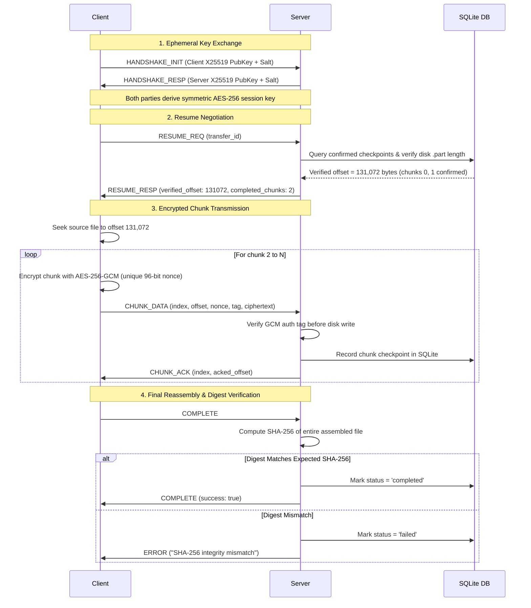

# Agnos Transfer Protocol (ATP) — Wire Specification

## 1. Framing Overview

TCP is an unstructured stream of bytes; a single `recv()` call is never guaranteed to return a full application message or stop at a message boundary.

The **Agnos Transfer Protocol (ATP v1)** defines an explicit length-prefixed framing format that precedes every message over the TCP socket.

### 9-Byte Framing Header

```
 0                   1                   2                   3
 0 1 2 3 4 5 6 7 8 9 0 1 2 3 4 5 6 7 8 9 0 1 2 3 4 5 6 7 8 9 0 1
+-+-+-+-+-+-+-+-+-+-+-+-+-+-+-+-+-+-+-+-+-+-+-+-+-+-+-+-+-+-+-+-+
|                       Magic: "ATP1"                           |
+-+-+-+-+-+-+-+-+-+-+-+-+-+-+-+-+-+-+-+-+-+-+-+-+-+-+-+-+-+-+-+-+
|   MsgType (1B)|              Body Length (4B, BE)             |
+-+-+-+-+-+-+-+-+-+-+-+-+-+-+-+-+-+-+-+-+-+-+-+-+-+-+-+-+-+-+-+-+
| ... Body Payload (Body Length bytes) ...                      |
+-+-+-+-+-+-+-+-+-+-+-+-+-+-+-+-+-+-+-+-+-+-+-+-+-+-+-+-+-+-+-+-+
```

| Field | Size | Type | Description |
|---|---|---|---|
| `Magic` | 4 bytes | ASCII | Constant bytes `b"ATP1"` identifying protocol version 1. |
| `MsgType` | 1 byte | uint8 | Message type identifier (0x01 to 0x0E). |
| `Body Length` | 4 bytes | uint32 (Big-Endian) | Exact byte length of the variable payload immediately following the header. |

---

## 2. Message Types

| ID | Name | Direction | Payload Content |
|---|---|---|---|
| `0x01` | `HANDSHAKE_INIT` | Client → Server | Client Ephemeral X25519 PubKey (32B) + Client Salt (4B). |
| `0x02` | `HANDSHAKE_RESP` | Server → Client | Server Ephemeral X25519 PubKey (32B) + Server Salt (4B). |
| `0x03` | `AUTH_REQ` | Client → Server | Authentication credentials / JWT token (JSON). |
| `0x04` | `AUTH_RESP` | Server → Client | Authentication result and role (JSON). |
| `0x05` | `TRANSFER_INIT` | Client → Server | File metadata: Transfer ID, filename, size, chunks, SHA-256 (JSON). |
| `0x06` | `TRANSFER_ACK` | Server → Client | Acknowledgment and verified starting resume byte offset (JSON). |
| `0x07` | `CHUNK_DATA` | Client → Server | Binary Chunk Frame (60B header + AES-GCM ciphertext). |
| `0x08` | `CHUNK_ACK` | Server → Client | Acknowledged chunk index (uint32) + confirmed byte offset (uint64). |
| `0x09` | `RESUME_REQ` | Client → Server | Transfer ID and client claimed offset (JSON). |
| `0x0A` | `RESUME_RESP` | Server → Client | Server-validated resume offset and status (JSON). |
| `0x0B` | `COMPLETE` | Client ↔ Server | Final transmission notification & SHA-256 digest match confirmation. |
| `0x0C` | `ERROR` | Either | Error code and rejection reason (JSON). |
| `0x0D` | `PING` | Either | Keep-alive probe. |
| `0x0E` | `PONG` | Either | Keep-alive response. |

---

## 3. Binary Chunk Packet Layout (`CHUNK_DATA`)

Inside the framed body of message type `0x07`, the chunk carries a 60-byte fixed header followed by the raw AES-256-GCM ciphertext:

```
Struct Format: "!16sIQ12s16sI"
Total Header: 60 bytes
```

```
 0                   1                   2                   3
 0 1 2 3 4 5 6 7 8 9 0 1 2 3 4 5 6 7 8 9 0 1 2 3 4 5 6 7 8 9 0 1
+-+-+-+-+-+-+-+-+-+-+-+-+-+-+-+-+-+-+-+-+-+-+-+-+-+-+-+-+-+-+-+-+
|                                                               |
+                                                               +
|                   Transfer ID (16 bytes UUID)                 |
+                                                               +
|                                                               |
+-+-+-+-+-+-+-+-+-+-+-+-+-+-+-+-+-+-+-+-+-+-+-+-+-+-+-+-+-+-+-+-+
|                      Chunk Index (4 bytes, BE)                |
+-+-+-+-+-+-+-+-+-+-+-+-+-+-+-+-+-+-+-+-+-+-+-+-+-+-+-+-+-+-+-+-+
|                      Byte Offset (8 bytes, BE)                |
|                                                               |
+-+-+-+-+-+-+-+-+-+-+-+-+-+-+-+-+-+-+-+-+-+-+-+-+-+-+-+-+-+-+-+-+
|                      AES-GCM Nonce (12 bytes)                 |
|                                                               |
+-+-+-+-+-+-+-+-+-+-+-+-+-+-+-+-+-+-+-+-+-+-+-+-+-+-+-+-+-+-+-+-+
|                  Authentication Tag (16 bytes, MAC)           |
|                                                               |
+-+-+-+-+-+-+-+-+-+-+-+-+-+-+-+-+-+-+-+-+-+-+-+-+-+-+-+-+-+-+-+-+
|                   Ciphertext Length (4 bytes, BE)             |
+-+-+-+-+-+-+-+-+-+-+-+-+-+-+-+-+-+-+-+-+-+-+-+-+-+-+-+-+-+-+-+-+
| ... Ciphertext Payload (Ciphertext Length bytes) ...          |
+-+-+-+-+-+-+-+-+-+-+-+-+-+-+-+-+-+-+-+-+-+-+-+-+-+-+-+-+-+-+-+-+
```

---

## 4. State Machine & Resumption Flow


